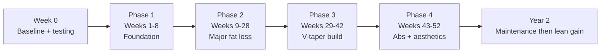

# 01 · Toji Project: Assessment and 12-Month Roadmap

> [!IMPORTANT]
> This is a coaching framework built on population averages and the numbers you gave me. Every estimate below gets replaced by **your real data** after 3–4 weeks of tracking. Your data wins over any calculator or formula, including mine.

**Documents in this system**
1. **This file**: assessment, baseline, anime vs. real anatomy, 12-month roadmap, monthly milestones, strength targets, supplements, medical and safety.
2. [02_Training_Program.md](file:///home/antigravity/.gemini/jetski/brain/v1/default/jetski_remote_agents_3p/1b1a0e13-73a5-4008-a7c1-8ac72d474425/02_Training_Program.md): the 6-day program, exercise technique library, progression, deloads.
3. [03_Nutrition_and_Fat_Loss.md](file:///home/antigravity/.gemini/jetski/brain/v1/default/jetski_remote_agents_3p/1b1a0e13-73a5-4008-a7c1-8ac72d474425/03_Nutrition_and_Fat_Loss.md): calories and macros, 7-day Indian meal plan, fat-loss strategy.
4. [04_Cardio_Routine_Tracking.md](file:///home/antigravity/.gemini/jetski/brain/v1/default/jetski_remote_agents_3p/1b1a0e13-73a5-4008-a7c1-8ac72d474425/04_Cardio_Routine_Tracking.md): cardio and steps, daily routine, tracking sheet, weekly review, plateau guide, adjustment rules.
5. [Toji_Transformation_Tracker.xlsx](file:///home/antigravity/.gemini/jetski/brain/v1/default/jetski_remote_agents_3p/1b1a0e13-73a5-4008-a7c1-8ac72d474425/Toji_Transformation_Tracker.xlsx): a spreadsheet that calculates weekly averages, rate of loss, body-fat estimates and lift trends for you.

---

## 0. Your profile and what it tells me

| Factor | Your answer | Coaching implication |
|---|---|---|
| Age / height / weight | 20 y, 181 cm, 110 kg | Young and recovers well. A big frame that can carry a lot of muscle. |
| Training age | 1–2 years, fairly consistent | **Early intermediate.** Not a beginner, not advanced. |
| Bench | 70 kg × 8 → estimated 1RM ≈ **85–89 kg** (≈ 0.8× bodyweight) | Decent absolute strength. Relative to bodyweight it's novice-intermediate. |
| Lat pulldown | 70 kg × 12 → estimated 1RM ≈ **95–98 kg** (stack) | Your strongest lift relative to bodyweight, which is a good sign for lat width. |
| Curl | 30 kg × 12 | Strong *if strict*. Check that your hips and lower back aren't swinging the weight. |
| Leg press | 110 kg × 20 | Light compared with your upper body and body mass. **Your legs are probably your most undertrained area** (sleds differ a lot, so treat this as a soft inference). |
| Squat / deadlift / OHP / rows / pull-ups | Unknown | Tested in Week 0 (see below). |
| Diet | Non-veg; vegetarian on Thursdays and Hindu festivals | Easy to hit protein. Thursday has its own vegetarian plan. |
| Injuries | None | Full exercise menu available. |
| Sleep | 7–8 h | Good. Protect it. |
| Daily activity | **~18,000 steps/day yearly average** + 20 min incline walking | This puts you in roughly the top few percent of the population. **Your maintenance calories are much higher than a typical calculator assumes**, and adding more cardio is *not* the main lever. |
| Budget | ₹7,000–10,000/month | Enough for the plan. Section 3.8 of the nutrition file has a budget version. |
| Food | Family cooks, you can request changes | The biggest hidden variable is **cooking oil**. See the nutrition file. |
| Equipment | Full commercial gym | No restrictions. |

**Verdict:** *Early-intermediate upper body, novice lower body and barbell basics.* That's good news:
- Squat and deadlift will improve quickly for months, close to novice-style progression.
- You have a fairly high body-fat percentage, some training history and undertrained legs. That's the profile where **recomposition** (losing fat while gaining some muscle) is most likely. It isn't guaranteed, but it's plausible.
- Your upper body is already trained, so it progresses more slowly. It uses double progression.

---

## 1. Starting-point analysis

### 1.1 BMI and its limitations
**BMI = 110 ÷ 1.81² = 33.6** (WHO "Obese class I"; under the Asian cut-offs, ≥25 already counts as obese).

What BMI gets wrong:
- It can't tell muscle from fat. A muscular 110 kg lifter and a sedentary 110 kg person both score 33.6.
- It says nothing about *where* the fat sits. Abdominal (visceral) fat drives health risk, and South Asians develop metabolic risk at lower BMI and waist sizes than Europeans.
- **Better metrics for you:** waist circumference (Indian risk cut-off for men: **≥90 cm**) and **waist-to-height ratio** (healthy < 0.5, so your waist should be **< 90.5 cm**).

### 1.2 Estimated maintenance calories

| Method | Estimate |
|---|---|
| BMR (Mifflin-St Jeor): 10×110 + 6.25×181 − 5×20 + 5 | **≈ 2,136 kcal** |
| BMR × 1.55 ("active") | ≈ 3,310 kcal |
| BMR × 1.725 ("very active") | ≈ 3,685 kcal |
| Built up from components: BMR + digestion (~300) + walking ~13–14 km/day beyond a sedentary baseline (~550–650 net) + 20 min incline at 15% / 4 km/h (~270 net; ≈ 8 METs at your weight) + lifting (~200–250 net) | ≈ 3,500–3,700 kcal |

**Working maintenance estimate: 3,300–3,700 kcal/day, midpoint ≈ 3,500.**

Why it's a range: phone step counters can overcount by 5–15%, people's walking efficiency varies, and BMR equations have roughly ±10% individual error. Your **true maintenance** comes from data in weeks 3–6:

$$\text{TDEE} \approx \text{avg daily intake} + \frac{\text{avg weekly loss (kg)} \times 7700}{7}$$

(Ignore weeks 1–2. Early weight loss is mostly water and glycogen, which skews the formula.)

### 1.3 Body fat: an honest range, not a guess
**Plausible range: ~25–35%.** I'm not narrowing it further without measurements, and here's why:
- At BMI 33.6, a sedentary 20-year-old would usually be 32–38%. A man with years of hard training could be 22–25%.
- You've trained for 1–2 years, walk ~18k steps a day, and have good pulldown and bench numbers, which suggests you're not at the top of that range. Your undertrained legs suggest you're not at the bottom either.

**Methods, from best to worst:**

| Method | Typical error | Use |
|---|---|---|
| DEXA scan (≈ ₹2,000–4,000 in Indian cities) | ±1–2% for tracking over time | Best affordable one-off. Repeat at month 6 and 12 if you can. |
| US Navy tape formula (neck + waist + height) | ±3–4% | Free, good for trends. Calculated automatically in the tracker. |
| RFM (Relative Fat Mass) = 64 − 20 × (height ÷ waist) | ±3–5% (validated against DEXA) | Free, only needs your waist. Calculated in the tracker. |
| Bioimpedance scales | Swings with hydration | Weak for absolute values. Use only for trends, at the same time of day. |
| "Eyeballing" / AI photo estimates | Very unreliable | Don't use. |

**RFM quick-lookup for you (waist measured at the navel):**

| Waist (cm) | 100 | 105 | 110 | 115 | 120 |
|---|---|---|---|---|---|
| RFM estimate | ~28% | ~29.5% | ~31% | ~32.5% | ~34% |

### 1.4 Lean body mass (LBM)
LBM = weight × (1 − body-fat fraction) = **≈ 71.5–82.5 kg** across the 25–35% range.

> [!NOTE]
> At higher body fat, part of what counts as "lean mass" is extra water, glycogen, connective tissue and larger organs needed to support the extra weight. As you lose fat, some of that disappears too, so a DEXA scan will probably show *some* lean-mass drop even if your actual muscle is maintained or growing. Don't panic about it. Strength, arm and shoulder measurements and photos tell the real story.

### 1.5 Realistic target weights at different body-fat levels
The table assumes your *end* LBM is 70, 75 or 80 kg (some non-muscle lean mass lost, some muscle gained):

| Body fat | LBM 70 kg | LBM 75 kg | LBM 80 kg | What it looks like |
|---|---|---|---|---|
| 20% | 87.5 kg | 93.8 kg | 100 kg | Athletic in clothes, no abs, waist much smaller |
| 15% | 82.4 kg | 88.2 kg | 94.1 kg | Muscular, shoulders and arms defined, faint upper abs in good light |
| 12% | 79.5 kg | 85.2 kg | 90.9 kg | Visible abs in good light, clear V-taper |
| 10% | 77.8 kg | 83.3 kg | 88.9 kg | **"Toji-inspired" zone**: abs visible most of the time, vascular arms |

**Takeaway:** your visible-abs weight will most likely land somewhere in **~80–92 kg**. We don't chase a scale number. We chase a **waist of ~80–84 cm with strength maintained or rising**, and let the scale settle wherever it lands.

### 1.6 Anime proportions vs. real human anatomy
Toji is drawn with shoulders nearly twice the width of his waist, traps up to his ears, wing-like lats, and stage-lean conditioning on what looks like a 100 kg frame. No natural human looks exactly like that, and nobody holds that condition year-round.

**What's realistically achievable ("Toji-inspired"):**

| Metric | Real-world elite natural target |
|---|---|
| Shoulder circumference ÷ waist | **1.5–1.6** (e.g. 128 cm shoulders ÷ 82 cm waist = 1.56) |
| Body fat | 9–12% (abs visible). Holding 8–10% year-round is hard on hunger and energy. |
| FFMI (LBM ÷ height²) | 23–25 (natural ceiling ≈ 25). At 181 cm: FFMI 23 → 75 kg LBM, FFMI 24 → 79 kg LBM. |
| Bodyweight at that look | **≈ 85–90 kg at 181 cm** |

Clavicle width, rib-cage size, muscle insertions and where you store fat are genetic. Training can't change them, but delts, lats and a smaller waist can change the *visual ratio* a lot.

**Honest timeline:** 12 months should take you to a lean, athletic, clearly V-tapered physique. Whether abs are visible at month 12 depends mostly on where your body fat actually starts. The full "Toji density" (more muscle at ~10%) usually takes **another 1–3 years of lean-gain phases** after the fat-loss year.

---

## 2. Baseline protocol: Week 0 (Mon 9 Nov → Sun 15 Nov 2026)

Diwali falls around 8 Nov. **Enjoy the festival, then use the following week to collect data before the deficit starts on Mon 16 Nov.**

### 2.1 Measurements (Sunday 15 Nov, morning, fasted, after the toilet)
Use a flexible cloth tape, snug but not compressing the skin. Take each measurement twice and record the average. **Same person, same spots, every time.**

| Site | How |
|---|---|
| Body weight | Every morning of Week 0. Use the 7-day average as your baseline. |
| Waist @ navel | Tape level, relaxed belly, measure at the end of a normal exhale. **Your most important number.** |
| Waist narrowest | Narrowest point between the ribs and the navel. |
| Neck | Just below the Adam's apple, tape sloping slightly down at the front (needed for the Navy formula). |
| Chest | Under the armpits, across the nipples, arms relaxed, normal exhale. |
| Shoulders | Around the widest point of the delts, arms relaxed at your sides (a partner helps). |
| Arm | Relaxed *and* flexed, at the peak of the biceps, right arm. |
| Thigh | Midway between hip crease and kneecap, right leg, standing. |
| Hips | Widest point of the glutes. |

### 2.2 Progress photos (every 2 weeks, same conditions)
- **Setup:** same room and lighting (overhead light or facing a window), phone at navel height about 2.5 m away on a timer, plain wall, same shorts. Morning, fasted.
- **Poses (6):** front relaxed, side relaxed (left), back relaxed, front double biceps, back lat spread, front "abs and thigh" (hands behind head).
- Photos catch changes the scale misses, especially during recomposition.

### 2.3 Calibration eating
Log your **normal** intake for Week 0 in an app (HealthifyMe, MyFitnessPal or Cronometer) without changing anything. If your weight was stable before Diwali, that intake ≈ your maintenance. Diwali-week food will run higher than usual, so treat this as a rough check.

### 2.4 Strength testing (during your normal Week 0 sessions)
**No true 1-rep maxes.** They're unnecessary and risky without good technique. Instead:
1. Warm up, then work up to a set of **5–8 reps at RIR 1** (you could have done one more rep with good form) on: **back squat, deadlift (or trap-bar deadlift), standing overhead press, barbell row, bench press.**
2. **Pull-ups:** max strict reps from a dead hang, chin over the bar. Zero is a perfectly normal result at 110 kg.
3. Log load × reps in the tracker. The estimated 1RM is calculated automatically.
4. If a lift feels technically shaky (most likely squat or deadlift), stop at a comfortable weight and spend Phase 1 on technique.

### 2.5 Medical check: see Section 7.

---

## 3. 12-Month Roadmap

**Schedule of deloads and diet breaks:** a training deload every **6th week** (weeks 6, 12, 18, 24, 30, 36, 42, 48). Weeks **12, 24, 36 and 48** are also **diet-break weeks** (eat at maintenance).

| Phase | Weeks (≈ dates) | Calories (start) | Target loss rate | Expected weight at end |
|---|---|---|---|---|
| 1. Foundation | 1–8 (mid-Nov → mid-Jan) | 2,700 | 0.6–0.9% BW/wk (after the water drop) | **102–106 kg** |
| 2. Major fat loss | 9–28 (mid-Jan → end-May) | adjusted by data, ≈ 2,550–2,700 | 0.5–0.8% BW/wk | **93–99 kg** |
| 3. V-taper build | 29–42 (Jun → Aug) | ≈ 2,400–2,600 | 0.4–0.6% BW/wk | **89–95 kg** |
| 4. Abs + aesthetics | 43–52 (Sep → mid-Nov 2027) | ≈ 2,300–2,500 | 0.3–0.6% BW/wk | **85–92 kg** |

Calories drop through the year because a lighter body burns less, both at rest and while walking 18k steps. The exact numbers come from your weekly reviews, not this table.

### Phase 1: Foundation and fat-loss adaptation (Weeks 1–8)
- **Duration:** 8 weeks (Training Block 1 = weeks 1–6 with a deload in week 6; Block 2 starts in week 7).
- **Target weight:** 110 → **102–106 kg**. Expect **1.5–3 kg off in the first 7–10 days**. That's water, glycogen and gut content, not fat. Then ~0.6–1.0 kg/week.
- **Performance targets:** clean technique on squat, deadlift and OHP. **+5–10% estimated 1RM** on bench and OHP, **+10–20%** on squat and deadlift. Pull-ups: 3 × 5 with assistance that's steadily decreasing. Bench ≈ 75 kg × 8.
- **Visual changes:** face and neck slimmer, clothes looser, **waist −4 to −8 cm**. Not much visible muscle change yet. That's normal.
- **Nutrition:** 2,700 kcal, 180 g protein. Main skill to build: hitting protein daily and getting the family's oil use under control.
- **Training:** volume at the low end of each range. RIR 3 in week 1 → RIR 1 in week 5. Exam weeks: drop to the 4-day fallback (training file §9) and keep protein the same.

### Phase 2: Significant fat reduction and muscle development (Weeks 9–28)
- **Duration:** ~20 weeks, with diet breaks in weeks 12 and 24.
- **Target weight:** **93–99 kg** by the end.
- **Performance targets:** bench 80–85 kg × 6–8, big squat and deadlift progress, **first strict bodyweight pull-ups** (usually somewhere around 95–100 kg bodyweight), OHP +10% over baseline.
- **Visual changes:** jawline appears, shoulders *look* wider because the waist shrinks, arms show separation when pumped. If you start at the lower end of the body-fat range, you may see an upper-ab outline in good light by the end.
- **Nutrition:** cut calories in 100–150 kcal steps only when the 2-week trend stalls. Protein stays at 170–180 g. Holi falls around late March 2027: plan it as a maintenance day.
- **Training:** from Block 3, add +1 set to side-delt and lat work. Push for strength on the main lifts. Exam weeks: switch to the fallback plan.

### Phase 3: Building the athletic, muscular V-taper (Weeks 29–42)
- **Duration:** ~14 weeks, with a diet break in week 36.
- **Target weight:** **89–95 kg**.
- **Performance targets:** **6–10 strict pull-ups**, OHP ≈ 0.55–0.6× bodyweight for 5, bench ≈ 1× bodyweight for reps, deadlift ≈ 1.6× bodyweight estimated 1RM.
- **Visual changes:** a clear V-taper from the front, rounded delts, lat flare visible when relaxed, forearm veins, an ab outline in most light.
- **Nutrition:** smaller deficit (0.4–0.6%/wk). Put more of your carbs before and after training. Hunger gets harder from here, so use the strategies in the nutrition file.
- **Training:** **V-taper specialization.** Side delts trained 5×/week (laterals added on leg days), +2 rear-delt sets, +2 sets each for biceps and triceps. Quad and hamstring volume drops to maintenance (≈ 8–10 sets/week).
- **Summer (April–June):** train indoors, drink more water, add electrolytes (see the medical section).

### Phase 4: Advanced aesthetics and abdominal definition (Weeks 43–52)
- **Duration:** ~10 weeks, with a diet break and deload in week 48.
- **Target weight:** **85–92 kg** (whatever weight gives you **waist ≈ 80–86 cm** with strength intact).
- **Performance targets:** **keep heavy loads on the bar**. Maintaining strength while lean counts as success. Pull-ups 10–12 or weighted +10 kg × 5.
- **Visual changes:** if you started at ≤ ~30% body fat, abs should be visible in good light and the V-taper obvious. If you started higher, you'll be at ~15–18% with a strong athletic look.
- **Nutrition:** calories likely 2,300–2,500 (decided by data). Protein can go up to 190 g if hunger is high.
- **Training:** same split. If recovery suffers in the deficit, cut 1 set from each isolation exercise but **keep the intensity**.
- **Decision at Week 52:**
  - **Waist ≤ ~84 cm / abs visible →** 2–4 weeks bringing calories back up to maintenance, then a **lean gain** (surplus +200–300 kcal, gaining ~0.25–0.5 kg/month) to build size.
  - **Still ≥ ~16% →** keep cutting into months 13–16. **Don't start bulking at high body fat.**

---

## 4. Monthly progress milestones

"Month" ≈ 4–5 weeks from the 16 Nov start. **Waist changes are measured against your Week 0 navel waist.** These are realistic ranges, not promises. Being near the top or bottom of a range is normal.

| Month (≈) | Phase | Weight (kg) | Waist change | Strength / performance checkpoint | Focus |
|---|---|---|---|---|---|
| 1 (Nov–Dec) | 1 | 104–107 | −3 to −6 cm | Squat/DL technique solid. Full program done ≥ 90% of sessions. | Habits, oil control, protein daily |
| 2 (Dec–Jan) | 1 | 102–105 | −5 to −9 cm | Bench 72.5–75 × 8. Assisted pull-up assistance down 10 kg. | First deload done. New Year/exams handled. |
| 3 (Jan–Feb) | 2 | 100–103 | −7 to −11 cm | Squat/DL e1RM +15–25% vs baseline | Diet break wk 12. First DEXA re-check optional. |
| 4 (Feb–Mar) | 2 | 98–101 | −8 to −13 cm | 1–3 strict pull-ups likely | Steps steady ≥ 16k |
| 5 (Mar–Apr) | 2 | 96–99 | −10 to −15 cm | Bench 80 × 6–8 | Holi plan. Summer hydration. |
| 6 (Apr–May) | 2 | 94–97 | −11 to −17 cm | OHP +10%. Row ≈ 75–80 × 8. | Diet break wk 24. **Mid-year DEXA/blood re-test.** |
| 7 (May–Jun) | 2→3 | 92–96 | −12 to −18 cm | 3–6 strict pull-ups | Start V-taper specialization (wk 29) |
| 8 (Jun–Jul) | 3 | 91–95 | −13 to −20 cm | Deadlift ≈ 1.5–1.6× BW e1RM | Hunger management |
| 9 (Jul–Aug) | 3 | 90–94 | −14 to −21 cm | Pull-ups 6–8 | Diet break wk 36 |
| 10 (Aug–Sep) | 3→4 | 89–93 | −15 to −22 cm | Bench ≈ 1× BW × 5+ | Navratri (~Oct) planning |
| 11 (Sep–Oct) | 4 | 88–92 | −16 to −23 cm | Strength maintained at a lower BW | Diet break wk 48 |
| 12 (Oct–Nov) | 4 | 85–91 | −17 to −25 cm | All 12-month strength targets (below) | **Week-52 decision: lean gain vs continue cut** |

---

## 5. Strength targets (adjusted after Week 0 testing)

Your bodyweight should fall by ~20 kg while these numbers rise, so your **strength-to-weight ratio will roughly double on bodyweight movements**. "e1RM" = estimated 1-rep max from your rep sets (Epley formula, calculated in the tracker).

| Lift | Now | Month 3 | Month 6 | Month 12 (realistic) | Month 12 (very good) |
|---|---|---|---|---|---|
| **Bench press** | 70 × 8 (e1RM ≈ 87) | 75 × 8 (≈ 95) | 80 × 8 or 85 × 5 (≈ 100) | 85 × 6 (≈ 102) | 90 × 6 / 100 × 1–2 (≈ 108) |
| **Back squat** | Test in Wk 0 | Baseline e1RM +15–25% | +25–40% | **≈ 110 × 5 (e1RM ≈ 125–130)** | 120–125 × 5 |
| **Deadlift** | Test in Wk 0 | Baseline +15–25% | +25–40% | **≈ 130–140 × 5 (e1RM ≈ 150–160)** | 150 × 5 |
| **Overhead press** | Test in Wk 0 | Baseline +5–10% | +10–15% | **≈ 55 × 5 (e1RM ≈ 63)** | 60 × 5 |
| **Pull-ups (strict)** | Test (likely 0–3) | 3 × 5 lightly assisted | 3–6 bodyweight | **8–12 bodyweight** | +10 kg × 5 |
| **Barbell row** | Test in Wk 0 | 70 × 8 | 75–80 × 8 | **85–90 × 8 strict** | 100 × 6 |

**How to adjust:**
- If your baseline is **below** these numbers: aim for the *percentage* gains (squat/DL +15–25% by month 3, bench/OHP +5–10%), not the absolute numbers.
- If your baseline is **above** them: aim for +5–10% e1RM every 3 months on bench/OHP/row and +10% on squat/DL.
- All targets assume **clean technique**. A rep that breaks form doesn't count.
- In late Phase 3–4, **holding** strength is a win. Upper-body numbers often plateau in deep deficits.

---

## 6. Supplements: what's essential and what's optional

> [!IMPORTANT]
> **The essentials are not supplements:** a calorie deficit, 170–180 g protein/day, fruit and vegetables, 4–5 L water, 7–9 h sleep and progressive training. Supplements change your results by a few percent at most.

| Supplement | Evidence | Verdict for you | How |
|---|---|---|---|
| **Creatine monohydrate** | The strongest evidence of any legal supplement. Increases strength and lean mass alongside resistance training. Safe in healthy people across decades of studies. | **Recommended** (~₹600–1,200 per 250 g, enough for ~2 months) | 3–5 g/day, any time, every day. No loading phase needed. Plain monohydrate only. |
| **Whey protein** | It's food. Matches other proteins when total intake is the same. Useful because it's convenient and high in leucine. | **Optional / convenience.** The plan uses ~1 scoop on 5 days. | 25–30 g scoop. Choose a brand with third-party testing (India has adulteration problems: check for lab reports or verified authenticity codes). Skip it to save ~₹2,000/month and replace it with soy chunks, eggs or curd. |
| **Caffeine** | Reliable performance boost at 3–6 mg/kg, but it **disrupts sleep** for up to 6–10 h. | **Situational.** If you train in the evening, **don't take caffeine before training.** Keep it to morning tea or coffee, ≤ 200 mg, nothing after ~1 pm. | Never use proprietary "pre-workout" blends. |
| **Vitamin D** | Deficiency is very common in India. Correcting it helps bone, immune and possibly muscle function. Little benefit if your levels are already normal. | **Test first** (25-OH vitamin D). | If deficient: follow your doctor's protocol (in India often 60,000 IU weekly for 8 weeks, then maintenance). If normal: sunlight plus 1,000–2,000 IU/day is reasonable. |
| **Omega-3 (EPA + DHA)** | Small or inconsistent effects on muscle. Benefits for triglycerides and heart health. | **Optional.** Prefer fish: rohu/katla, or cheap fatty fish like **mackerel (bangda) and sardines (mathi)** 1–2×/week. | If you rarely eat fish: 1–2 g EPA + DHA/day. Flax and walnuts give ALA, which the body converts poorly. |
| **Don't buy** | Fat burners, testosterone boosters, BCAAs (pointless when protein is adequate), mass gainers, L-carnitine, "detox" products, SARMs/steroids | **No.** | Fat burners are mostly caffeine plus risky stimulants. Test boosters don't work in healthy men. |

**Note:** creatine adds **0.5–1.5 kg of water** to muscle over 3–4 weeks. If you start it in Week 0, that gain happens while your baseline is being set and won't hide fat loss later. It also slightly raises blood **creatinine**, so get your baseline blood test before you start, or tell the lab/doctor you take it.

---

## 7. Medical and safety considerations

### 7.1 Do you need a medical check first?
Under the ACSM pre-participation guidelines, someone who **already exercises regularly with no symptoms and no known heart, metabolic or kidney disease** doesn't need medical clearance to continue. That's you.

**I still strongly recommend a one-time baseline check.** At BMI 33.6, and as a South Asian male (higher cardiometabolic risk at a given weight), it's cheap insurance and gives you health targets beyond the mirror.

**Suggested baseline panel** (typically ₹1,500–3,500 as a package at a reputable lab; fasting 10–12 h; **no hard training for 48 h before**, because heavy lifting temporarily raises liver enzymes and CK):

| Test | Why |
|---|---|
| Blood pressure (clinic or home, **large cuff** if your arm is > 33 cm) | Hypertension is often silent. Target < 120/80. |
| Fasting glucose + **HbA1c** | Screens for prediabetes, common at your BMI in India |
| Lipid profile | Triglycerides and HDL improve a lot with fat loss, which is motivating to see |
| Liver function (ALT/AST) | **Fatty liver** is common at this BMI and reverses with fat loss |
| TSH | Rules out a thyroid cause of weight gain |
| 25-OH Vitamin D, Vitamin B12 | Common deficiencies in India |
| CBC, creatinine/eGFR, uric acid | General baseline (get creatinine *before* starting creatine) |

**Re-test at month 6 and month 12.** Better blood markers are part of the transformation.

### 7.2 Joint stress and injury prevention
- **Feet, shins, Achilles:** 18k steps plus incline walking at 110 kg is a big repetitive load. At ~13 km/day you cover **~400 km/month**. **Rotate two pairs of good walking shoes and replace each pair every ~4–6 months.** Pain on the inside of the shin, heel pain on first steps in the morning (plantar fascia), or Achilles stiffness means reduce the incline and steps for a week. Don't push through it.
- **Treadmill:** most treadmills show *percent* grade, max 15%. "15" at 4 km/h is a hard but appropriate effort. Hold the rails only lightly for balance.
- **Knees:** they can take squats and lunges fine. Control the lowering and progress load gradually. Joint pain is different from muscle soreness: **joint pain → change the exercise; soreness → normal.**
- **Lower back:** brace for every hinge and squat. Use straps on heavy pulls so your grip doesn't make your form break down. Deadlifts are programmed only once a week.
- **Shoulders:** you do a lot of pressing, so the program includes plenty of face pulls, rear-delt work and rows (roughly 1:1 pull:push).
- **Safety equipment:** squat and bench inside a rack with safety arms set just below your bottom position, or use a spotter.

### 7.3 Cardiovascular fitness
Your walking volume already gives you a solid aerobic base. A falling **resting heart rate** (measured on waking, from your watch or by hand) shows improving fitness. A morning RHR that's **> 7–10 bpm above your normal** for 2–3 days means poor recovery, illness or too much stress, so take the day easy.

### 7.4 Heat and hydration (Indian summer, Apr–Jun)
Drink to pale-yellow urine. Add electrolytes on hot days (lemon water with a pinch of salt, or ORS). Move incline walking to the air-conditioned gym if possible. Never cut water or salt to "look leaner".

### 7.5 Red flags: stop training and see a doctor
Chest pain or pressure, fainting or near-fainting, palpitations, breathlessness far beyond what's normal for you, **cola-coloured urine after training** (possible rhabdomyolysis), sudden severe headache during lifting, or joint pain that changes how you move.

### 7.6 Mental health and your relationship with food
Track food precisely but stay relaxed about it. One higher-calorie day doesn't undo anything; only the weekly average matters. If you notice binge cycles, constant food anxiety, or dread around meals, tell me and we'll loosen the structure (for example, track protein only and eat from a fixed meal template).
