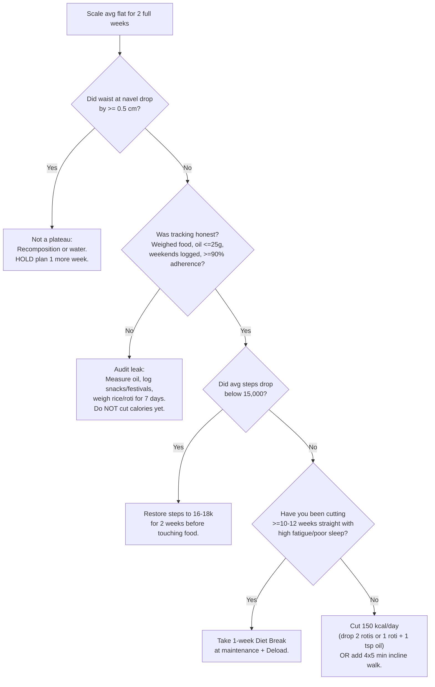

# 04 · Cardio, Daily Routine, Tracking System, and Plateau Guide

← Back to [01_Roadmap_and_Assessment.md](file:///home/antigravity/.gemini/jetski/brain/v1/default/jetski_remote_agents_3p/1b1a0e13-73a5-4008-a7c1-8ac72d474425/01_Roadmap_and_Assessment.md) · [02_Training_Program.md](file:///home/antigravity/.gemini/jetski/brain/v1/default/jetski_remote_agents_3p/1b1a0e13-73a5-4008-a7c1-8ac72d474425/02_Training_Program.md) · [03_Nutrition_and_Fat_Loss.md](file:///home/antigravity/.gemini/jetski/brain/v1/default/jetski_remote_agents_3p/1b1a0e13-73a5-4008-a7c1-8ac72d474425/03_Nutrition_and_Fat_Loss.md) · Spreadsheet: [Toji_Transformation_Tracker.xlsx](file:///home/antigravity/.gemini/jetski/brain/v1/default/jetski_remote_agents_3p/1b1a0e13-73a5-4008-a7c1-8ac72d474425/Toji_Transformation_Tracker.xlsx)

---

## 1. Cardio and daily activity strategy

### 1.1 The key coaching call on your steps
Your yearly average is **~18,000 steps/day** (Pomodoro walks + walking to the gym + campus), and you sometimes push to 20–25k.
- **Do not try to progress above 18,000–20,000 steps.** At 18k you're already getting almost all the fat-loss and health benefit walking can offer. Pushing to 25k+ in a calorie deficit while learning heavy squats and deadlifts mostly adds foot, shin and knee wear and leg fatigue.
- In a calorie deficit, the body subconsciously tries to move *less* (fidgeting drops, you sit more). **Your real job is preventing your steps from quietly sliding down to 10–12k as you get leaner**, not raising the ceiling.

### 1.2 Step targets across the year

| Situation | Daily step floor | Daily target band | Soft cap |
|---|---|---|---|
| **Normal weeks (all 4 phases)** | 15,000 | **16,000–20,000** | 22,000 |
| **Deload / diet-break weeks** | 14,000 | 15,000–18,000 | 20,000 |
| **Exam weeks** | **12,000** (keep the Pomodoro walks: they help memory and focus too) | 12,000–15,000 | — |
| **Sunday (rest day)** | 12,000 | 14,000–16,000 | — |

### 1.3 Structured cardio alongside 6 lifting days

| Day | Lifting | Structured cardio (after lifting) | Why |
|---|---|---|---|
| Mon | Push A | **20 min incline walk** · 12–15% grade · 3.8–4.0 km/h | High calorie burn, zero eccentric muscle damage |
| Tue | Pull A | **20 min incline walk** · 12–15% · 3.8–4.0 km/h | Same |
| Wed | Legs A (Squat) | **15–20 min upright or recumbent bike** (easy, conversational pace) *or* incline walk at **8–10%** | Gives your calves, Achilles and lower back a break after squats and RDLs |
| Thu | Push B | **20 min incline walk** · 12–15% · 3.8–4.0 km/h | — |
| Fri | Pull B | **20 min incline walk** · 12–15% · 3.8–4.0 km/h | Keeps legs fresher for Saturday deadlifts |
| Sat | Legs B (Deadlift) | **15 min easy bike** *or* skip (your walk home is enough) | Protects recovery |
| Sun | Rest | **None.** Casual walking only. | Full recovery day |

**Total structured cardio:** **95–115 minutes/week** across 5–6 sessions.

### 1.4 Cardio progression across the 12 months
- **Phase 1–2 (Weeks 1–28):** keep cardio exactly as above. Let the **diet** do the work.
- **Phase 3 (Weeks 29–42):** only if fat loss stalls *and* you'd rather not cut food below ~2,400 kcal, add **5 minutes** to the four upper-body-day sessions (**25 min × 4 + 15–20 min × 2 ≈ 135 min/week**).
- **Phase 4 (Weeks 43–52):** hard cap at **150 min/week** of structured cardio. Never add HIIT or running in deep phases of a cut at your size.

### 1.5 Rules so cardio never hurts muscle recovery
1. **Always lift first, cardio second** (or separate them by ≥ 6 hours).
2. **No running or plyometrics above 95 kg.** The peak impact per step is 2.5–3× bodyweight. Walking and cycling do the same job for fat loss with a fraction of the joint stress.
3. **Don't hang on the treadmill handrails.** Leaning back while holding the rails turns a 15% incline into an effective 5–8% incline and stresses your wrists and shoulders. Light fingertip touch for balance only. If you have to grip hard, drop the incline to 12%.
4. **Heart-rate / effort check:** Zone 2 (roughly **125–145 bpm** at age 20, or "can speak in short sentences"). If you're gasping, slow down to 3.5 km/h or drop the incline to 12%.

---

## 2. Daily routine: waking to sleeping (college + evening gym)

Adjust the clock times by ±1 hour to match your class schedule; **keep the sequence and gaps the same.**

| Time | Block | What to do |
|---|---|---|
| **06:45** | Wake up | Use the toilet → **weigh yourself naked/in briefs** → log weight in [Toji_Transformation_Tracker.xlsx](file:///home/antigravity/.gemini/jetski/brain/v1/default/jetski_remote_agents_3p/1b1a0e13-73a5-4008-a7c1-8ac72d474425/Toji_Transformation_Tracker.xlsx). Drink **500 ml water** (add a pinch of salt in summer). Step onto the balcony/terrace for 5–10 min of morning daylight. |
| **07:15–08:00** | **Meal 1 (Breakfast)** | Cook/eat breakfast + **3–5 g creatine** mixed in water or milk + Vitamin D (if taking). Pack your lunch tiffin and pre-workout snack before leaving. |
| **08:30–13:00** | Classes / study block 1 | Every ~100 min of sitting, take your **20-min Pomodoro walk (~2,000 steps)**. Sip **1.5 L water** across the morning. Optional black coffee/tea before 12:30 pm (**no caffeine after 1 pm**). |
| **13:00–13:30** | **Meal 2 (Lunch tiffin)** | Eat lunch + salad/curd. Short 10-min easy walk after eating helps blood-sugar control and digestion. |
| **13:30–16:15** | Classes / study block 2 | 1–2 more Pomodoro walks. Another **1 L water**. |
| **16:15–16:30** | **Meal 3 (Pre-workout)** | Whey + milk + banana (or day's equivalent), **60–75 min before lifting**. |
| **17:10–17:30** | Walk to gym | ~1,500 steps. Acts as your general warm-up. |
| **17:30–18:50** | **Lifting (80 min)** | 8–10 min ramp-up → ~70 min working sets. Log every working set's weight and reps in a phone app (Hevy / Strong) or notebook **between sets**. Sip 750 ml–1 L water. |
| **18:50–19:10** | **Incline walk / bike (20 min)** | 12–15% at 4 km/h on upper days; easy bike on leg days. |
| **19:10–19:30** | Walk home | ~1,500 steps cool-down. |
| **19:45–20:30** | Shower + **Meal 4 (Dinner)** | Biggest carb + protein meal of the day to refill glycogen and drive recovery. |
| **20:30–21:45** | Study / family / relax | Light tasks. Log the day's food, steps and session in the tracker (takes 2 minutes). |
| **21:45** | **Meal 5 (Before bed)** | Hung curd / milk + fruit (slow-digesting casein protein overnight). Dim lights, phone on night mode. |
| **22:30–06:45** | **Sleep (8 h 15 min in bed → ~7.5–8 h actual sleep)** | Cool, dark room. Phone across the room so you get up at the first alarm. |

**If you train in the morning (e.g. 7:00–8:40 am):** eat the Pre-workout meal at 6:15 am, train, eat Breakfast as your post-workout meal at 9:00 am, and keep Lunch, an afternoon snack (swap in Dinner's dal/soya portion) and Dinner in the same macro totals.

---

## 3. Weekly tracking dashboard and Sunday review

Open [Toji_Transformation_Tracker.xlsx](file:///home/antigravity/.gemini/jetski/brain/v1/default/jetski_remote_agents_3p/1b1a0e13-73a5-4008-a7c1-8ac72d474425/Toji_Transformation_Tracker.xlsx). **Yellow cells are your inputs; grey/white cells calculate automatically.**

### 3.1 What you log and when

| Frequency | Metrics |
|---|---|
| **Every morning (30 s)** | Body weight (kg), hours slept |
| **Every evening (2 min)** | Steps, calories, protein (g), session completed, incline walk minutes, 1–5 hunger & energy score, quick note (e.g. "hostel party", "salty dinner", "PR on bench") |
| **Every week in Key Lifts tab** | Best top-set weight × reps for **Bench, Squat, Deadlift, OHP, Barbell Row, Lat Pulldown**, plus **Pull-up assistance/added weight × reps** (the sheet calculates estimated 1RM) |
| **Every Sunday morning (10 min)** | **Waist at navel, waist narrowest, neck, chest, shoulders, flexed right arm, right mid-thigh** (the sheet calculates weekly averages, % bodyweight change, RFM BF% and US Navy BF%) |
| **Every 2nd Sunday (Week 0, 2, 4, 6...)** | **6 progress photos** in identical morning fasted lighting |

### 3.2 Sunday review template (copy into a notes app or the tracker's decision column)
```text
WEEK #: ___   Dates: _________
1. Avg weight this wk: ____ kg   Last wk: ____ kg   Change: ____ kg (____% BW)
2. Waist @ navel: ____ cm (change vs 2 wks ago: ____ cm)
   Shoulders: ____ cm   Arm (flexed): ____ cm   Thigh: ____ cm
3. Avg kcal: ____   Avg protein: ____ g   Days on plan (/7): ___
4. Avg steps: _____   Sessions completed (/6): ___   Avg sleep: ____ h
5. Key lifts (up / flat / down vs 2 wks ago):
   Bench: ___  Squat: ___  DL: ___  OHP: ___  Row: ___  Pull-up: ___
6. Hunger (1-5): ___   Energy (1-5): ___   Joint pain? _________
7. Decision for next week (pick ONE using Section 5 rules):
   [ ] Hold everything the same
   [ ] Cut 150 kcal (from carbs/fat)
   [ ] Add 150 kcal
   [ ] Fix adherence / oil / steps first
   [ ] Deload / diet break
```

---

## 4. Plateau troubleshooting guide

**Definition of a real fat-loss plateau:** your **7-day average weight has changed by < 0.3% BW/week for 2 full weeks in a row** *and* **your navel waist has not dropped by ≥ 0.5 cm over those 2 weeks**. Anything shorter is water noise.



### The 6 common "fake plateaus" (check these before cutting food)
1. **The oil/peanut/paneer leak:** family added an extra ladle of oil, you eyeballed peanuts or paneer, or you didn't count festival mithai/namkeen. *Fix:* weigh and log 100% of intake for 7 days.
2. **Started creatine in the last 3 weeks:** adds 0.5–1.5 kg of intracellular muscle water. Waist keeps shrinking while the scale pauses. *Fix:* wait it out.
3. **High-salt or restaurant meal in the last 48 h:** holds 1–2 kg of water. *Fix:* look at the 7-day average, not Tuesday's weigh-in.
4. **Heavy new leg training / soreness:** muscle inflammation holds water for up to 72 h.
5. **Constipation / more fibre than usual:** gut content weighs 0.5–1.5 kg. Drink 5 L water, keep walking.
6. **Subconscious step drop:** your phone shows 13k instead of 18k (~200–250 kcal/day less burn). *Fix:* bring steps back to 16–18k.

---

## 5. Clear rules for adjusting the plan based on actual results

Apply these **only on Sundays**, using **2-week trends**. Make **one change at a time** so you know what worked.

| What your 2-week data shows | Exact adjustment to make on Monday |
|---|---|
| **Losing 0.5–0.9% BW/wk (Phases 1–2) or 0.4–0.7% (Phases 3–4)** and lifts are stable/rising | **Change nothing.** Never touch a working plan. |
| **Losing < 0.4% BW/wk for 2 straight weeks, waist flat, adherence ≥ 90%, steps ≥ 16k** | **Cut 150 kcal/day:** remove 2 rotis (or 150 g cooked rice), *or* 1 roti + 5 g oil. Keep protein at 180 g. |
| **Losing > 1.1% BW/wk for 2 straight weeks** (after Week 3) | **Add 150–200 kcal/day** from carbs (+1.5–2 rotis or +150 g cooked rice). You're losing too fast and risking muscle. |
| **Scale flat for 2 weeks, but waist dropped ≥ 1 cm and lifts went up** | **Hold.** You're gaining muscle while losing fat. Re-evaluate in 2 more weeks. |
| **Adherence < 85%** (missed logging, weekend overeating, festival week) | **Do not cut calories.** Resume the current target for 2 clean weeks first. |
| **Two or more key lifts drop > 10% in e1RM over 2 weeks** *plus* poor sleep or constant soreness | Take an **immediate deload week** (half sets, RIR 4) and bring calories **up by +300 kcal** (carbs) for 7 days. |
| **One single lift stalls for 3 weeks** while others progress | Keep diet the same. **Reset that lift by −10% load** and build back up, or swap to the listed alternative in the next block. |
| **Every 12th week (Weeks 12, 24, 36, 48)** | **Planned diet break** (+400–600 kcal from carbs to reach current maintenance) paired with your **training deload**. |
| **Calorie target reaches 2,200 kcal/day** | **Floor reached.** Do not cut food further. Take a 2-week maintenance diet break, or add 5 min to upper-day incline walks. |

---

## 6. Your first 7 days: action checklist

- [ ] **Buy:** digital kitchen scale (₹300–500), cloth measuring tape (₹50), creatine monohydrate, and a notebook or workout-logging app.
- [ ] **Book (optional but recommended):** morning fasting blood panel + blood-pressure check before starting creatine.
- [ ] **Sunday morning (baseline day):** weigh in, take all 9 tape measurements, take the 6 baseline photos, and enter them in **Week 0** of [Toji_Transformation_Tracker.xlsx](file:///home/antigravity/.gemini/jetski/brain/v1/default/jetski_remote_agents_3p/1b1a0e13-73a5-4008-a7c1-8ac72d474425/Toji_Transformation_Tracker.xlsx).
- [ ] **Week 0 in the gym:** run the 6 sessions at RIR 2–3 and record your 5–8 rep working weights on squat, deadlift, OHP, barbell row, bench and pull-ups.
- [ ] **Talk to your family once:** show them the 1-teaspoon-oil rule and ask them to scoop your dal/sabzi before the heavy tadka.
- [ ] **Monday of Week 1:** start the 2,700 kcal / 180 g protein plan and Block 1 Week 1.
